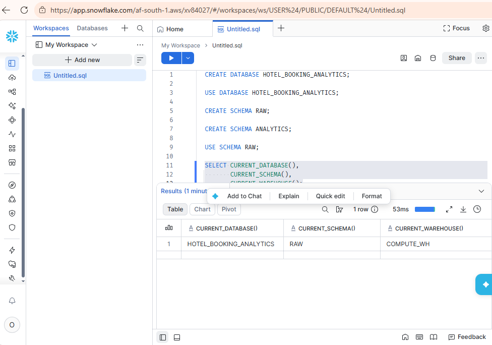
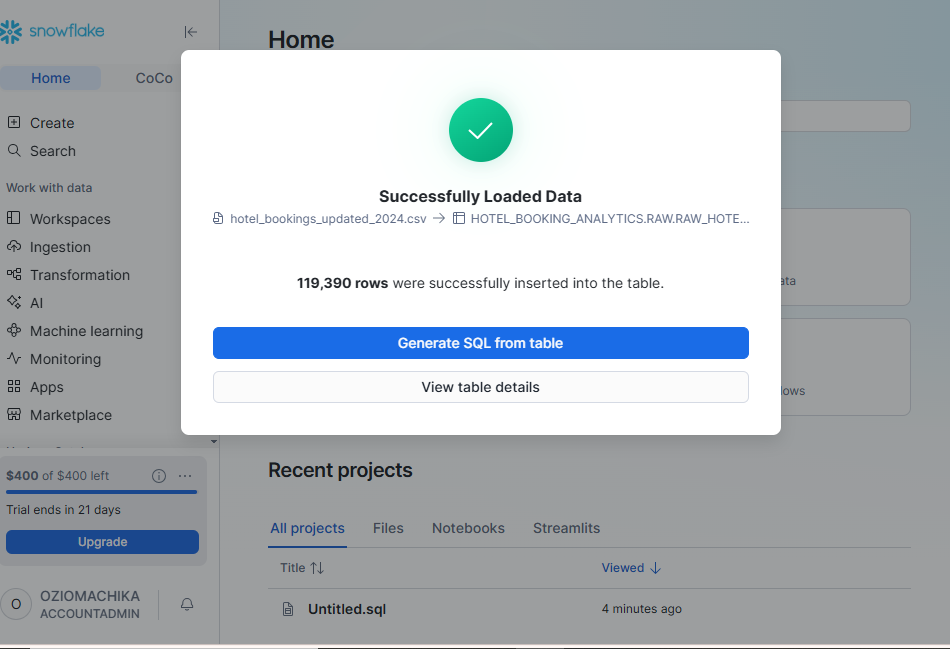
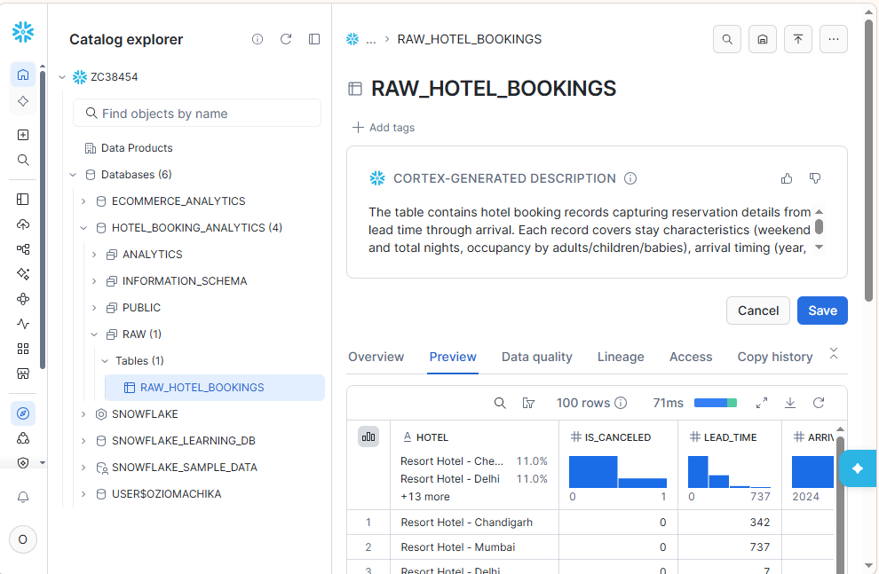
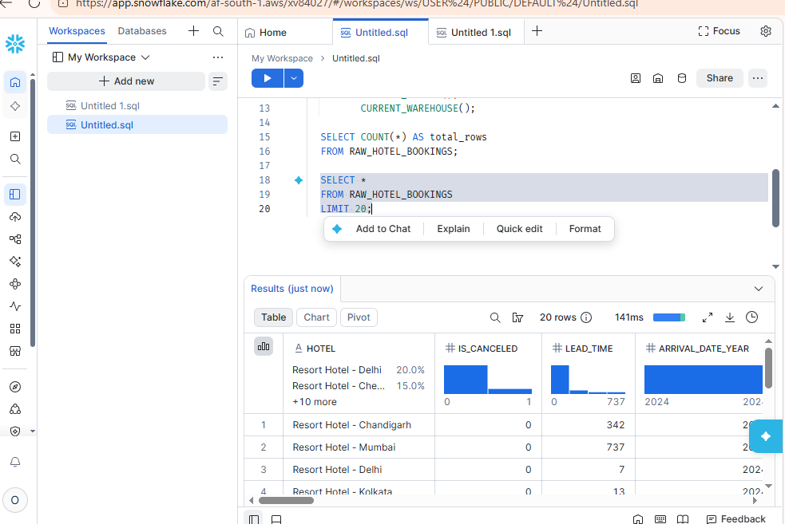
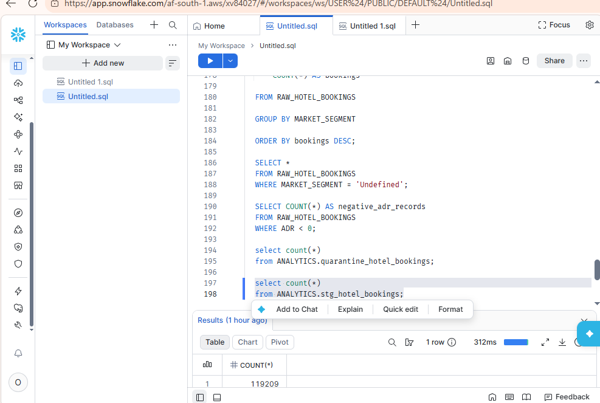
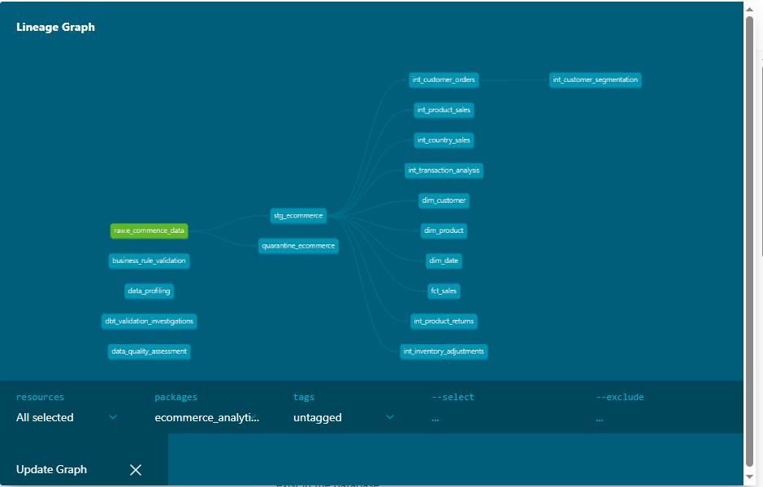

# Hotel Booking Analytics Engineering Platform

 

## Overview

This project demonstrates an end-to-end Analytics Engineering workflow using Snowflake and dbt.

The objective was to ingest raw hotel booking data, perform data profiling and quality assessment, implement business-rule validation, isolate invalid records, create analytics-ready datasets, and build a dimensional data model for downstream reporting and business intelligence.

The project follows modern Analytics Engineering practices including:

- Source profiling
- Data quality assessment
- Business rule discovery
- Quarantine layer implementation
- Automated dbt testing
- Dimensional modeling
- Documentation
- Data lineage generation

---

## Technology Stack

### Cloud Data Warehouse

- Snowflake

### Analytics Engineering

- dbt Core

### Data Modeling

- Star Schema
- Fact Tables
- Dimension Tables

### Development

- SQL
- Git
- GitHub

### Data Quality

- Source Profiling
- Data Quality Assessment
- Automated Testing
- Quarantine Strategy

---

## Dataset

### Source

Hotel Booking Demand Dataset

### Records Ingested

119,390

### Raw Table

RAW_HOTEL_BOOKINGS

### Snowflake Database

HOTEL_BOOKING_ANALYTICS

---

## Business Problem

Hotel booking systems generate large volumes of transactional and reservation data. Before analytical reporting can occur, data must be assessed, validated, transformed, and organized into trusted analytical models.

This project demonstrates the creation of a cloud-based analytics platform capable of supporting:

- Booking analysis
- Cancellation analysis
- Customer segmentation
- Market segment reporting
- Country-level reporting
- Revenue and ADR analysis

---

## Architecture
```text
                        ┌──> quarantine_hotel_bookings (Invalid Records)
                        │
RAW_HOTEL_BOOKINGS ─────┤
                        │
                        └──> stg_hotel_bookings (Cleaned & Standardized)
                                    │
                                    ▼
                        ┌───────────────────────┐
                        │  Intermediate Layer   │
                        │  • int_cancellation   │
                        │  • int_country        │
                        │  • int_customer_type  │
                        │  • int_market_segment │
                        │  • int_deposit        │
                        └───────────┬───────────┘
                                    │
                  ┌─────────────────┴─────────────────┐
                  ▼                                   ▼
      ┌───────────────────────┐           ┌───────────────────────┐
      │   Mart: Dimensions    │           │      Mart: Facts      │
      │  • dim_country        │◄─────────►│  • fct_bookings       │
      │  • dim_customer_type  │  (FK/PK)  │                       │
      │  • dim_hotel          │           │                       │
      │  • dim_market_segment │           │                       │
      └───────────────────────┘           └───────────────────────┘

```
---
## Repository Structure

```text
hotel_booking_analytics_project/
├── analyses/                       # Ad-hoc SQL profiling & validation scripts
│   ├── business_rule_discovery.sql
│   ├── data_quality_assessment.sql
│   ├── model_validation.sql
│   └── source_profiling.sql
├── data/                           # Raw source dataset
│   └── hotel_bookings_updated_2024.csv
├── documentation/                  # Domain & data quality documentation
│   ├── business_rules.md
│   ├── data_quality_assessment.md
│   ├── data_quality_rules.md
│   └── source_system_assessment.md
├── models/
│   ├── staging/                    # Source cleaning & quarantine triage
│   │   ├── quarantine_hotel_bookings.sql
│   │   ├── stg_hotel_bookings.sql
│   │   └── schema.yml
│   ├── intermediate/               # Business rule transformations
│   │   ├── int_cancellation_analysis.sql
│   │   ├── int_country_bookings.sql
│   │   ├── int_customer_type_analysis.sql
│   │   ├── int_deposit_analysis.sql
│   │   └── int_market_segment_analysis.sql
│   └── marts/                      # Kimball Star Schema
│       ├── dimensions/
│       │   ├── dim_country.sql
│       │   ├── dim_customer_type.sql
│       │   ├── dim_hotel.sql
│       │   └── dim_market_segment.sql
│       ├── facts/
│       │   └── fct_bookings.sql
│       └── schema.yml
├── screenshots/                    # Snowflake & dbt execution evidence
├── dbt_project.yml                 # dbt project configuration
└── README.md
```
---


## Source System Assessment

### Dataset Statistics

| Metric | Value |
|----------|---------:|
| Total Records | 119,390 |
| Total Columns | 32 |
| Duplicate Records | 0 |

### Initial Findings

- Arrival dates stored across multiple columns
- Missing country values
- Missing agent values
- Missing company values
- Invalid guest records identified
- Negative ADR values identified

---

## Data Quality Assessment

### Missing Value Analysis

| Column | Missing Records |
|----------|---------------:|
| COUNTRY | 488 |
| CHILDREN | 4 |
| AGENT | 16,340 |
| COMPANY | 112,593 |
| CITY | 0 |

- COUNTRY contains 488 missing values (0.41% of records). The impact on geographical analysis is minimal, therefore records were retained for analytical processing.
- CHILDREN contains four missing values. Null values were standardized to zero during staging to support guest-count calculations.
- AGENT contains 16,340 missing values (13.69%). Investigation suggests these records represent direct bookings rather than invalid data and were retained.
- COMPANY contains 112,593 missing values (94.31%). The high null rate reflects individual traveler bookings rather than data quality failures. Records were retained for analysis.
## Duplicate Record Analysis
### Findings
| Metric | Value |
|----------|---------:|
| Total Records | 119,390 |
| Distinct Records | 119,390 |
### Outcome
- No exact duplicate records were identified within the source dataset.
- The dataset demonstrates strong row-level uniqueness and does not require duplicate-removal logic during ingestion.

### Critical Data Quality Findings

#### Invalid Guest Records

Rule:

```sql
Adults + Children + Babies = 0
```

Records Identified:

```text
180
```

Action:

```text
Quarantined
```

---

#### Negative ADR Values

Rule:

```sql
ADR < 0
```

Records Identified:

```text
1
```

Action:

```text
Quarantined
```

---

## Quarantine Strategy

Records failing critical quality checks are isolated within:

```text
quarantine_hotel_bookings
```

This approach preserves analytical integrity while maintaining visibility into problematic source data.

### Quarantine Rules

#### Rule 1

```sql
COALESCE(Adults,0)
+ COALESCE(Children,0)
+ COALESCE(Babies,0) = 0
```

#### Rule 2

```sql
ADR < 0
```

Records violating either rule are excluded from downstream analytics models.

---

## Business Rule Discovery

### Cancellation Analysis

| `is_canceled` | Booking Status | Bookings | Share |
| :---: | :--- | ---: | ---: |
| `0` | Completed | 75,166 | 62.96% |
| `1` | Cancelled / No-Show | 44,224 | 37.04% |

A **37.04% cancellation rate** represents a major revenue risk and drives the core analytical questions of this platform:
- Which hotel types and countries experience the highest cancellation rates?
- How do deposit policies (`No Deposit` vs. `Non Refund`) impact cancellations?
- Which market segments and customer types carry the highest cancellation risk?
### Deposit Types

Valid values identified:

- No Deposit
- Non Refund
- Refundable

### Customer Types

Valid values identified:

- Transient
- Transient-Party
- Contract
- Group

### Market Segments

Valid values identified:

- Online TA
- Offline TA/TO
- Groups
- Direct
- Corporate
- Complementary
- Aviation

---

## dbt Model Layers

### Staging Layer

Models:

- stg_hotel_bookings
- quarantine_hotel_bookings

### Intermediate Layer

Models:

- int_cancellation_analysis
- int_country_bookings
- int_customer_type_analysis
- int_market_segment_analysis
- int_deposit_analysis

## dbt Model Layers

### 1. Staging Layer (`models/staging/`)
Standardizes raw column names, casts data types, handles nulls (e.g., coalescing missing `children` to `0`), and splits valid records from anomalous records.
- `stg_hotel_bookings`: Cleaned, analytics-ready booking records (`119,209` valid rows).
- `quarantine_hotel_bookings`: Isolated records failing critical quality checks (`181` rows).

### 2. Intermediate Layer (`models/intermediate/`)
Applies modular business rules and domain-specific aggregations to support downstream analytical reporting:
- `int_cancellation_analysis`
- `int_country_bookings`
- `int_customer_type_analysis`
- `int_market_segment_analysis`
- `int_deposit_analysis`

### 3. Mart Layer — Kimball Star Schema (`models/marts/`)
Built for self-service BI reporting with a clear separation between conformed dimensions and transactional facts:

* **Dimensions (`models/marts/dimensions/`):**
  * `dim_hotel`: Hotel property attributes (`Resort Hotel`, `City Hotel`) — **PK:** `hotel`
  * `dim_country`: Guest country of origin codes — **PK:** `country`
  * `dim_customer_type`: Booking customer classifications (`Transient`, `Contract`, `Group`, etc.) — **PK:** `customer_type`
  * `dim_market_segment`: Acquisition and booking channels (`Online TA`, `Direct`, `Corporate`, etc.) — **PK:** `market_segment`

* **Facts (`models/marts/facts/`):**
  * `fct_bookings`: Core transactional fact table at the **individual reservation grain** (one row per valid hotel booking). Contains booking metrics (lead time, stay duration, ADR, cancellation flags) linked to dimensions via **FKs:** `hotel`, `country`, `customer_type`, `market_segment`.
---

## Automated Testing

The project implements automated data quality validation using dbt tests.

### Test Categories

- not_null
- unique
- accepted_values
- relationships

### Final Validation Results

```text
PASS = 16
WARN = 0
ERROR = 0
```

Validation successfully confirmed:

- Dimension uniqueness
- Referential integrity
- Business-rule compliance
- Analytical model integrity

---
## How to Run Locally

### Prerequisites
- A Snowflake account with a configured warehouse, database (`HOTEL_BOOKING_ANALYTICS`), and raw schema (`RAW`)
- Python 3.9+ with `dbt-snowflake` installed
- A local `~/.dbt/profiles.yml` configured with your Snowflake connection credentials

### Setup & Execution
1. **Clone the repository:**
   ```bash
   git clone [https://github.com/GOSPEL92/hotel-booking-analytics-engineering.git](https://github.com/GOSPEL92/hotel-booking-analytics-engineering.git)
   cd hotel_booking_analytics_project
---
## Project Screenshots

**Snowflake Environment Setup**

The Snowflake environment was configured to support the analytics platform. This included creating a dedicated warehouse, database, and schemas used for raw data ingestion and analytical model development.

### Snowflake Database Creation



Successful Snowflake account configuration and connectivity validation. This environment serves as the cloud data warehouse powering the analytics solution.

### Snowflake Data Loading



Hotel booking data was loaded into Snowflake and stored within the RAW schema. This layer preserves source records prior to transformation and quality validation.

### Raw Table Validation



Initial verification of the RAW_HOTEL_BOOKINGS table after ingestion. This step confirms successful loading and provides visibility into source-system structure and contents.

### Source Profiling



Exploratory analysis performed during source profiling and data quality assessment. The dataset was analyzed to identify missing values, invalid records, business-process anomalies, and transformation requirements.

## Automated Data Quality Testing



### dbt Lineage Graph



Complete data lineage generated using dbt documentation.
The architecture follows a layered Analytics Engineering approach:

- This lineage provides full transparency into model dependencies and data flow throughout the platform.

## Automated dbt test results


Automated dbt testing was implemented to validate model integrity and analytical readiness.

---

## Documentation & Supporting Analyses

### Domain & Quality Documentation (`documentation/`)
- [Source System Assessment](documentation/source_system_assessment.md)
- [Data Quality Assessment](documentation/data_quality_assessment.md)
- [Business Rules](documentation/business_rules.md)
- [Data Quality Rules](documentation/data_quality_rules.md)

### Exploratory & Validation SQL (`analyses/`)
- [Source Profiling](analyses/source_profiling.sql)
- [Data Quality Assessment](analyses/data_quality_assessment.sql)
- [Business Rule Discovery](analyses/business_rule_discovery.sql)
- [Model Validation](analyses/model_validation.sql)

---

## Key Outcomes

- Loaded 119,390 hotel booking records into Snowflake
- Designed a quarantine framework for invalid records
- Implemented layered dbt architecture
- Built dimensional models and fact tables
- Discovered and documented business rules
- Generated automated lineage documentation
- Implemented 16 automated dbt tests
- Achieved 100% test pass rate

---

## Future Enhancements

- Incremental dbt models
- Snapshot implementation
- Power BI dashboards
- Booking revenue forecasting
- Advanced customer segmentation
- Data observability monitoring
